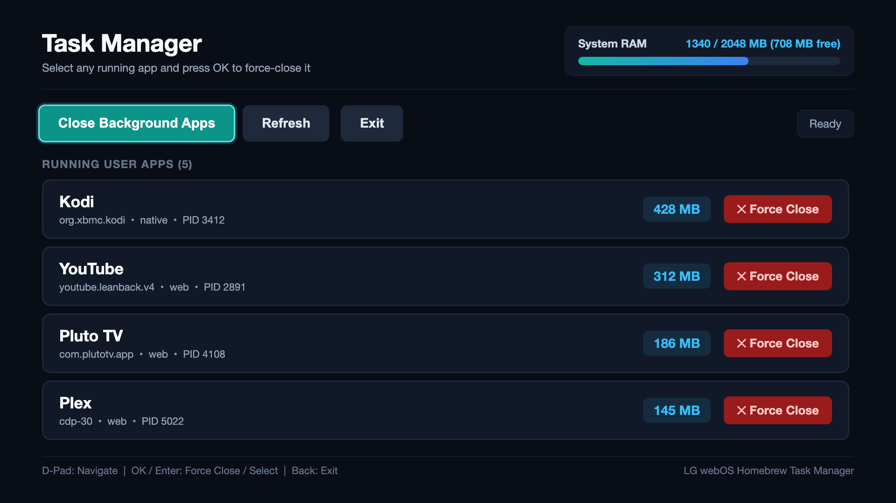

# PR Submission: Task Manager for webOS

**PR Title:**
```text
Add Task Manager (com.github.dasilva333.systemtools)
```

---

### PR Description Body:

```markdown
### New Application: Task Manager

**Package:** `com.github.dasilva333.systemtools`
**Category:** `system`
**Source:** https://github.com/dasilva333/webos-system-tools
**Release:** `v1.0.0`

### Description
Task Manager is a native process inspector and system diagnostic utility built specifically for LG webOS TVs. It provides sofa-friendly visibility into active user applications, PIDs, and per-process memory consumption, with the ability to terminate stuck or leaking background processes directly using the Magic Remote.

### Features
* **Live Process Inspector**: Displays all active background user applications, their system PIDs, application type (web vs native), and exact RSS memory consumption.
* **Remote D-Pad Process Termination**: Highlight any hung, frozen, or leaking application with the D-pad and press OK / Enter to force-close it, reclaiming memory without requiring an SSH terminal session.
* **System Memory Gauge**: Live visual RAM bar tracking used, free, and total system memory with automated warning thresholds.
* **Background App Cleanup**: Single-action control to gracefully terminate non-essential background user processes while preserving core system services.
* **OLED Dark Aesthetic**: Custom high-contrast theme designed for comfortable readability from the couch.

### Screenshot


### Compatibility & Verification
* **Tested Device**: LG CX OLED (webOS 5.3.1 / Chromium 68)
* **Framework**: Vanilla HTML5/JS (ES5 compatible across webOS 1.x through webOS 11+)
* **Assets**: Verified open-source MIT license, 160px icon, 320px detail icon, and full 1920×1080 native screenshot included.

#### Submission checklist
- [x] I have tested this application on a real webOS TV.
- [x] I confirm that this submission complies with the repository rules.

#### AI-use declaration
- [x] AI assisted in code development, UI layout, and packaging.
```
